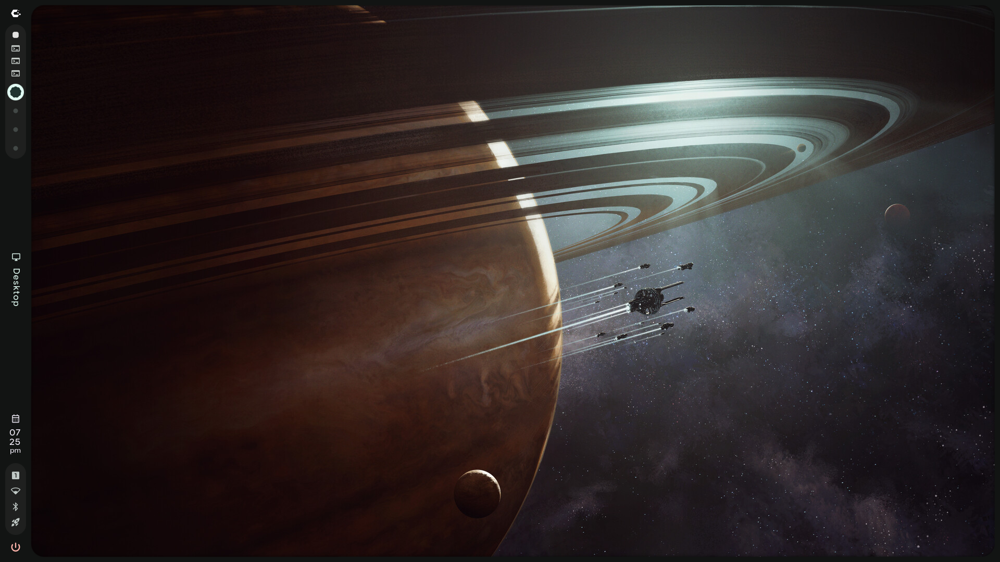
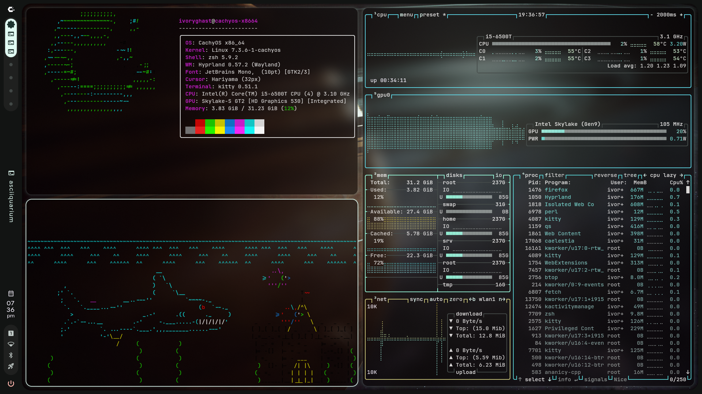

# Linux Rice v1

My dotfiles, wallpapers, system details and custom cursor.

## Screenshots

## Details
- **Distro:** CachyOS 
- **WM/DE:** Hyprland
- **Terminal:** Kitty 
- **Shell:** zsh + Powerlevel10k
- **Font:** Jet Brains Mono

## Contents
- `.config/`: application configs
- `Cursor/Hariyama/`: custom animated cursor (made by me)
- `Wallpapers/`: collected wallpapers

## Install the cursor
    cp -r Cursor/Hariyama ~/.local/share/icons/
    
**If that doesn't work**

    cp -r Cursor/Hariyama ~/.icons/

## Licensing & credits
Configs and the Hariyama cursor are released under the MIT License.
Wallpapers were collected from around the internet and are **not mine**.
All rights belong to their original creators. If you're the creator and
want something credited or removed, please open an issue.
